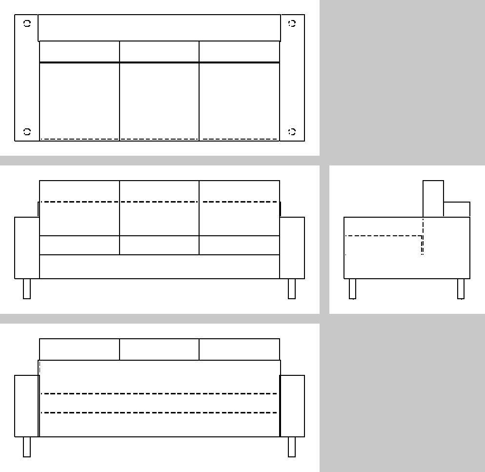
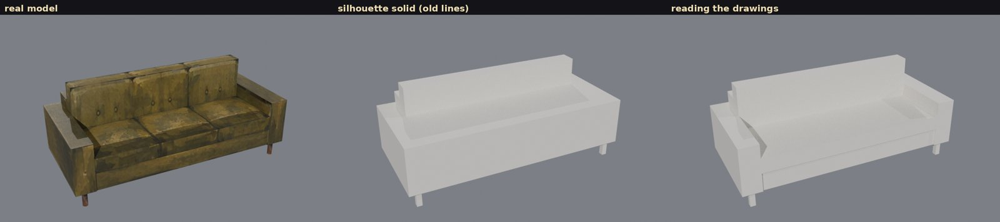
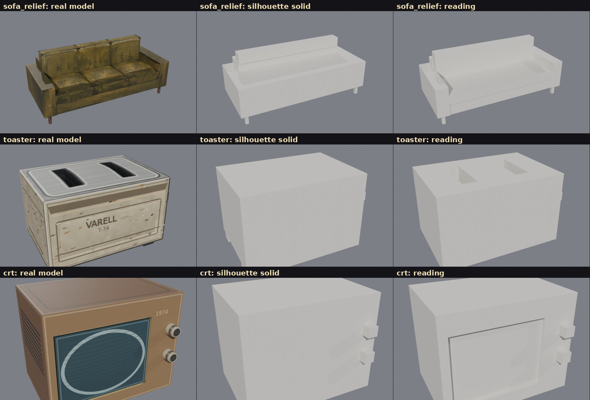

# Reading engineering drawings into solids (stage 1: rectilinear)

November 9 2026. Jared's idea: read the views together, the way an engineer reads a drawing set, so
that hollows like a sofa's seat come out right. Hull and sheet-set lines only intersect outlines,
and a hollow shows in none of them: the seat between the arms gets filled to arm height.

## Method (`tools/eng_read.py`, pure Python + numpy)
1. **Scale:** each view's ink extent is mapped to the overall dimensions, so slightly off-scale
   views still line up.
2. **Lines:** every long horizontal and vertical line, solid (visible) or dashed (hidden).
   Scraps are ignored. A plane counts only if it shows in two views, or as a long line in one.
3. **Blades:** each line becomes a plane through the object. Together the planes chop space into
   blocks.
4. **Start:** the silhouette solid, meaning the blocks inside every outline. This is what the
   hull lines build.
5. **Carve:** remove whole regions of blocks, one at a time, keeping each removal that best
   improves the match between the solid's own drawings and the given ones. Matching is line by
   line: present or not, visible or hidden. Drafting rules decide what a line can mean:
   - a dashed line is always a real hidden edge;
   - a visible line across a flush surface is a seam between parts.

## Test bench
- `tools/eng_draw.py` draws front, back, left, right, top and bottom views of any GLB, following
  drafting conventions:
  - outer edges are solid where visible and dashed where hidden;
  - flush joins between parts are drawn only where visible;
  - buried contact edges are not drawn;
  - a visible line wins over a hidden one in the same place.
- `tools/eng_eval.py` scores a reading by volume overlap (IoU, 1 cm lattice) against the model,
  and renders both.

Input to the reader: the six drawings plus the overall size, nothing else.

| Object | Silhouette solid (old lines) | Reading the drawings |
| --- | --- | --- |
| Sofa, flat cushions | 0.846 | **0.996** |
| Sofa, pillowy cushions (V1 build) | 0.867 | **0.932** |
| Toaster (slots on top) | 0.890 | **0.951** |
| CRT (recessed screen, glass inside) | 0.998 | 0.987 |





## What it shows
- **Hollows come out right.** The sofa's seat at cushion height and the toaster's bread slots
  can't come from silhouettes at all; reading the lines gives them.
- **CRT, slightly worse.** The reader carves the screen recess and leaves it empty. In the model,
  a bulged glass insert fills most of the recess, and the glass's curved outline breaks into
  fragments the reader ignores.
- **Curves become boxes.** Round legs come out as square posts; stage 2 would add arcs, circles
  and lathe parts.
- **The search is greedy.** It once took a wrong first carve: on an earlier version of the scoring
  it removed the seat cushions entirely. The fix was the drafting rules, not search tricks. A
  search that can undo steps (beam or annealing) would make it sturdier.

## Not yet tried
- **Drawings ChatGPT makes.** These drawings come from models. Real ones need a sheet of clean line
  views at one scale, hidden edges dashed. The reader already tolerates scraps, broken outlines
  and slightly different scales between views.
- **Wiring the reading into the factory.** Its blocks and seams are exactly what a V1 kit needs:
  part boxes, with seams marking separate cushions. With paint from the views, this could replace
  most hand-written V1 numbers.

## Reproduce
```bash
blender -b --factory-startup -P long-lines/tools/eng_draw.py -- MODEL.glb OUT/
python3 long-lines/tools/eng_read.py OUT/
blender -b --factory-startup -P long-lines/tools/eng_eval.py -- MODEL.glb OUT/read.json OUT/eval
cd long-lines && python3 -m unittest tests.test_eng_read
```
