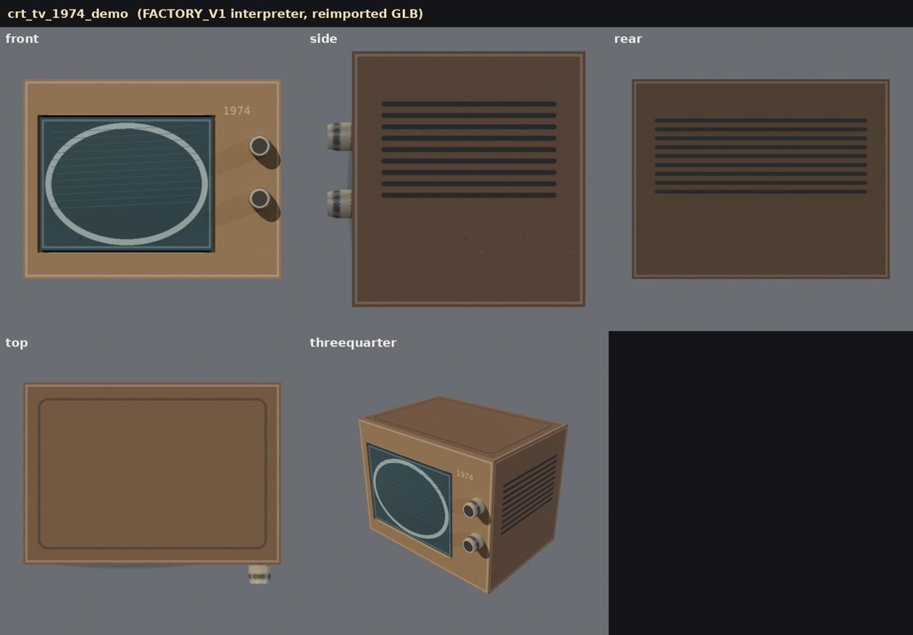
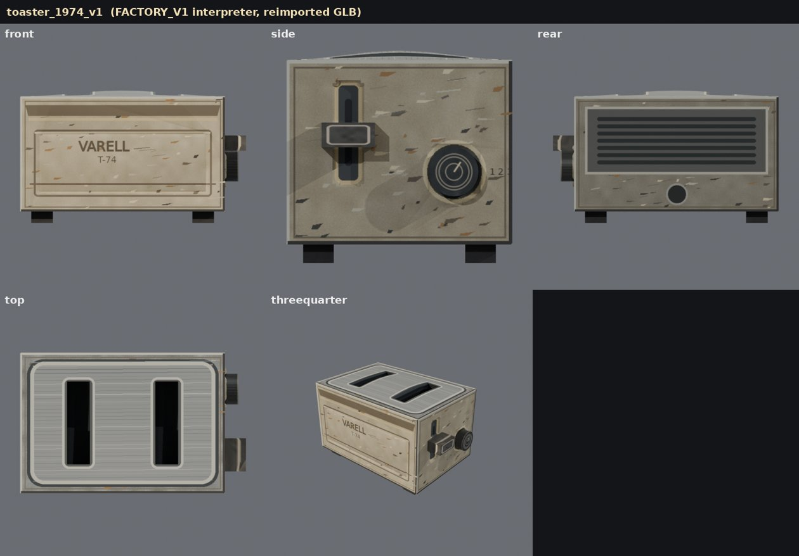
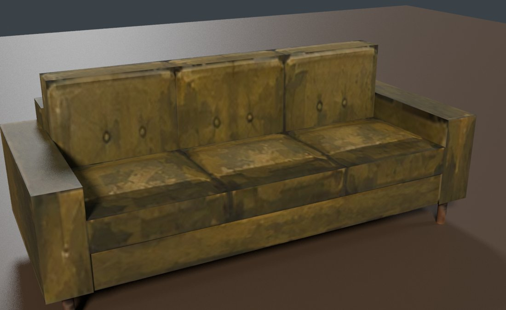
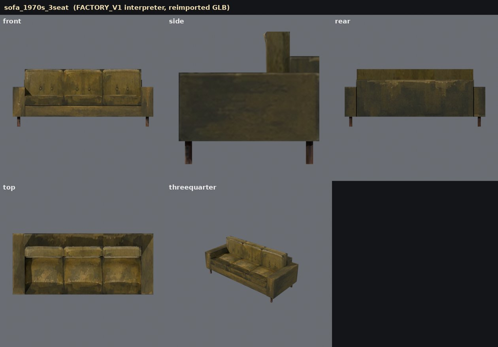

# FACTORY_V1 integration: generic assembly interpreter

November 9 2026. Branch `claude/factory-v1-assembly`, cut from production
(`claude/trusting-dirac-bxfmv6` at 335809d), with PR #4 merged in. Run in the cloud container
(Blender 4.0.2, Cycles CPU).

## 1. Technical state before this work (Phase A)

| PR | Branch | What it is | Verdict |
| --- | --- | --- | --- |
| #4 | `chatgpt/factory-v1-package-contract` | Spec, palette, two JSON schemas, `validate_package.py`, CRT example, 16 tests, CI | **Safe to merge.** Adds files only, plus 20 lines in `factory/README.md`. Merges into production without conflicts. Validator and all 16 tests pass. |
| #2 | `chatgpt/sheetfirst-panels-v1` | Sheet-first engine: open surface patches | Not merged. Reused: panel placement, cylinder arc length, half-texel UV inset. |
| #3 | `chatgpt/sheetfirst-toaster-assembly-test` | Toaster built by a toaster-specific script | Not merged. Reused: zero displacement on seams, cavities as omitted cells + walls + floor, GLB reimport with seam weld. Not reused: top-only cavities, global grid lines, hard-coded parts. |

Compatibility problems found in PR #4. None of them stop the merge; the second group shows
the example passing preflight while being physically wrong.

- **Spec gaps:**
  - The spec doesn't define `anchor_m`. The CRT example uses face centre for the dials and
    minimum corner for the glass.
  - The spec doesn't say which way v runs or which way normals point.
  - The spec doesn't say what the brief dimensions include.
  - The builder now fixes all four conventions, and FACTORY_V1.md, "Blender builder",
    documents them.
- **The preflight never checks placement**, so the CRT example passed while:
  - the recess sat 17 mm away from the painted cavity;
  - the glass, an open sheet, sat 21 mm in front of the cabinet;
  - the knobs sat 2 mm off the front face and 9 mm away from their painted circles;
  - the glass "bulge" depth was a ring with a flat centre (a bug in the demo generator).
- **Generated PNGs were not git-ignored.** They are now.

Every fix stayed in its own stage: the manifest for placement, the maps for the dome. The
production asset library, its lines and its gate are unchanged. `factory.py` only gains a
`v1` command.

## 2. What was built (Phase B)

- `tools/propkit/v1_geometry.py` (pure Python + Pillow): the interpreter. It reads the
  schema and turns panels, parts, connections and cavities into meshes. It contains no
  object names and no categories.
- `tools/propkit/v1_blender.py` builds the objects:
  - one material per semantic class, all on the original atlas;
  - the atlas is sRGB; depth and part IDs only drive geometry;
  - flat grid lines are dissolved;
  - it exports the GLB.
  
  Its `verify()` inspects the reimported file.
- `tools/factory_v1.py` is the command:
  - preflight → build → export → reimport in a fresh Blender → `qa.json` → five renders and a contact sheet;
  - `--suggest-welds PART` drafts box welds; it reproduces the CRT's 12 hand-written ones exactly;
  - `factory.py -- v1 ...` runs the same thing from Blender.
- Tests:
  - `tests/test_factory_v1_assembly.py`: 14 tests, no Blender;
  - `tests/test_factory_v1_blender.py`: end to end on both packages, skipped without Blender;
  - CI workflow `factory-v1-assembly.yml` builds both packages and uploads the GLBs,
    `qa.json` and renders as artifacts.
  
  All 32 tests pass (the 16 above plus PR #4's 16).

What each schema element becomes, and what is reported instead of built, is in
FACTORY_V1.md, "Blender builder":
- **Built:** closed box, panel shell, applique (sheet or solid), cylinder (with an optional
  wrap panel), rect cavities with or without a floor, weld/fold, flat and cylinder panels,
  signed depth.
- **Reported as unsupported (the build fails):** sweep, lathe, cavity liner, ellipse
  cavities, rotations, hinge/fasten geometry, welds across parts.

## 3. Results

Both packages were built by the same code. The second one needed no modelling script.

| | CRT (PR #4 example, corrected) | Toaster (PR #3 art as a V1 package) |
| --- | --- | --- |
| QA | **pass** | **pass** |
| Parts | 4: cabinet (closed box), glass (closed applique), 2 dials (cylinders) | 7: body (closed box), dial (cylinder + wrap panel), lever and 4 feet (closed appliques) |
| Operations | 12 welds, 1 rect cavity, relief on 1 panel, relief suppressed under 3 parts | 12 welds, 2 rect cavities, relief on 3 panels, relief suppressed under 6 parts |
| Closed after reimport (seams welded) | all 4 parts, 0 open edges | all 7 parts, 0 open edges |
| Cavity depth by ray cast | 12.0 mm (declared 12) | 38.0 / 38.0 mm (declared 38) |
| UV round trip | every authored sample found unchanged; atlas embedded | same |
| Texel density on main surfaces | 898 px/m (declared 900), 100% within 10% | 1596 px/m (declared 1600), 89% within 10% (dome and cavity walls) |
| Size vs brief | 0.58 × 0.41 × 0.45 m, matches the cabinet | 0.32 × 0.22 × 0.198 m, matches body width/depth and body + feet height |
| Triangles | 1,298 (medium budget 25,000) | 1,020 (small budget 6,000) |
| Build / reimport + renders | 3 s / 20 s | 5 s / 17 s |




Warnings QA reports but does not fail on:
- **Wall textures.** Walls without their own texture panel reuse the face texture, squeezed:
  - knob sides on the CRT: 3.6×;
  - toaster slot walls: 2.6×;
  - lever and feet sides: 1.7–3.5×.
  
  The schema has no way to give a cylinder's side, an applique's sides or a cavity's walls
  their own panel, except a cylinder wrap panel (the toaster dial uses one).
- **Parts deeper than declared.** The CRT knobs come out 16 mm deeper than declared because
  the demo map paints the whole knob cap as raised. The builder follows the map; the QA
  flags it.

## 4. What it took

Number of values authored per package:

| Package | Geometry values (panels, parts, connections, cavities) | Without the welds `--suggest-welds` drafts |
| --- | --- | --- |
| CRT | 299 | 227 |
| Toaster | 422 | 350 |

For comparison, the benchmark needed 1–9 values per object for the legacy factory and
87–155 for sheet-first v1.

On top of that, V1 needs three maps registered to one exact pixel scale. Both test packages
use programmatic art:
- the CRT uses PR #4's generator;
- the toaster uses PR #3's painter, with its components resampled to scale.

No package painted by an image model has been through this builder yet.

## 5. Answers

**A. Can it construct distinct objects from manifests alone?**
Yes, for objects made of boxes, slabs, cylinders and rectangular recesses:
- The CRT and the toaster go through identical code.
- A test renames every id and reverses the panel order, and gets the same geometry.
- Painting a hole without declaring it does not cut one.

Anything rounded, lathed or swept is reported as unsupported, not attempted.

**B. What still needs an AI?**
- Painting the three registered maps at one scale.
- Writing the manifest: panel rects, sizes, origins and axes; part placement; cavities.
- Deciding the construction: which pieces are separate parts, and which details are relief
  versus paint.

The builder, the weld drafting and the QA need no AI. The cheapest next automation would
read panel rects and part footprints from the part-ID map instead of typing them.

**C. Watertight models or just better textures?**
Watertight models. This is measured on the exported GLB, not on the scene in memory:
- every part that should be closed has 0 open edges;
- recesses are real geometry, at the declared depth;
- parts touch their parents;
- UVs are exactly the authored net.

Texture sharpness also improved: painted pixels are used directly at the declared density,
with no re-bake.

**D. Effort for sofas, chairs, lamps and rounded appliances?**
- **Lamps** need `lathe`: a revolve with a profile panel and arc-length UVs. About a day.
- **Rounded appliances** (a fridge with radiused corners) need non-rectangular panels:
  top/bottom outlines that follow curved corner panels. Today every panel is a rectangle,
  so a rounded box cannot close. About two days, plus a schema change (FACTORY_V2).
- **Chairs and sofas**:
  - Frames work today: closed boxes and appliques, with welds drafted automatically.
  - Soft cushions need an "inflated" construction, and curved backs need sweep or
    shaped panels. Two to four days.
  - Authoring will be heavy: a sofa is roughly 10 parts × 6 panels.

The builder is not the binding cost. Authoring 300+ registered values per object is.

**E. Can I use `/factory` regularly yet?**
Not yet:
- **The building side is ready for box-like props.** It catches its own mistakes and
  names the stage at fault.
- **The `/factory` package side is untested on real output.** The CRT example from the same
  project had four placement errors and a broken depth map.
- **Next step:** run `/factory` for three box-like props (a radio, a nightstand, a safe),
  build each with `factory_v1.py`, and count how many fail QA, at which stage, and how
  long each fix takes. If most pass after one round, it is usable for that class of object.

**F. Is this a meaningful improvement over the benchmark, counting visual quality and preparation effort?**
- **Against sheet-first v1 (benchmark B), yes.** For boxes it removes every defect the
  benchmark found:
  - open shells;
  - background fringes;
  - stretched panels;
  - fake holes;
  - floating parts.
- **Against the legacy factory (A), only partly.**
  - V1 gives crisper texture and exact, verified recesses and parts on box-like objects.
  - The legacy factory still covers shapes V1 can't build: rounded cabinets, mouldings,
    the armchair.
  - The legacy factory needs about 30–100× fewer authored values and no exactly registered art.
  
  Visual quality on these two objects is limited by the programmatic test art, so it can't
  fairly be scored against the benchmark's painted references.
- **Net:** a real step in construction quality, not yet in preparation cost. It pays off
  only if ChatGPT can produce valid packages cheaply. Run the test in E before using it in
  production.

## 6. Third object: the 1970s sofa from ChatGPT's concept sheet

ChatGPT's "1970s couch" sheet looks like a package but isn't one:
- **Maps:** the albedo, depth and part-ID maps are ~380 px panels inside one 1536 × 1024
  image, and they are not drawn to scale.
- **Part palette:** it isn't the V1 palette.
- **JSON:** there is only an excerpt, with sizes in centimetres.
- **The numbers disagree with the drawings:**
  - the excerpt gives 62 cm cushions, which on a 198 cm sofa leaves 6 cm arms; the painted
    front view shows about 17 cm arms;
  - the painted top view is about 30% short.

New tool: `tools/v1_pack.py` turns a short kit into a full V1 package. The kit lists one
line per part: a box by its corners or a cylinder by cap, radius and length, plus which
sheet crop paints each face. The packer then:
- works out every panel's placement;
- packs the panels at one pixel scale, so V1's scale rule holds by construction;
- resamples the crops and fills the sheet background out of them;
- re-encodes signed depth;
- paints the part IDs;
- drafts the welds.

Sofa input: `factory/examples/factory_v1_sofa/kit.json`, about 15 values per part.

| | Sofa |
| --- | --- |
| QA | **pass** (preflight and reimport checks) |
| Parts | 14: seat base, back frame, 2 arms (closed boxes), 3 seat + 3 back cushions (closed boxes, pillow relief from the sheet's depth), 4 legs (cylinders with the painted leg as wrap) |
| Welds | 120, all drafted by the packer |
| Size | 1.98 × 0.86 × 0.81 m, matching the brief |
| Triangles | 10,694 (large budget 40,000) |




Critically:
- **Recognisable at game distance, not up close.**
  - The paint is blurry because the sheet's albedo panel holds only about 136 px per metre.
  - Cushions and arms are sharp boxes; V1 has no rounding. The concept's soft, rounded
    cushions would need an "inflated box" construction.
- **The back is vertical.** The side views show it raked, and V1 has no rotation yet.
- **Not built:** the blanket (no cloth construction), separate tufting buttons (they stay
  painted), the leg taper.
- **Some textures are invented.** Faces the sheet never painted reuse fabric from the
  nearest painted panel. That covers cushion sides and backs and the frame faces hidden
  against other parts.
- **What it shows:** with the packer, authoring drops from ~70 values per box to ~15 per
  part. The rest of a ChatGPT sheet can be turned into a V1 package in about an hour of
  agent time.
- **What it doesn't show:** it is still not a hands-off `/factory` → model run. The
  sheet's own numbers had to be overruled by its drawings.

## Reproduce

```bash
python3 long-lines/factory/examples/factory_v1_crt_tv/generate_demo_maps.py
python3 long-lines/factory/examples/factory_v1_toaster/generate_maps.py
python3 long-lines/tools/factory_v1.py long-lines/factory/examples/factory_v1_crt_tv/asset.json
python3 long-lines/tools/factory_v1.py long-lines/factory/examples/factory_v1_toaster/asset.json
python3 long-lines/tools/v1_pack.py long-lines/factory/examples/factory_v1_sofa/kit.json
python3 long-lines/tools/factory_v1.py long-lines/factory/examples/factory_v1_sofa/asset.json
cd long-lines && python3 -m unittest tests.test_factory_v1_package tests.test_factory_v1_assembly tests.test_factory_v1_blender
```
